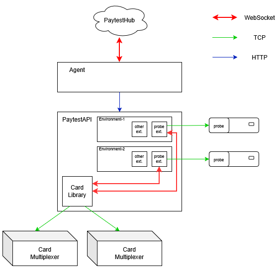

# PaytestLab API Definitions

Postman collections, environments and documentation that show how to integrate with the PaytestLab APIs:

| API | What it does | Reference documentation |
|-----|--------------|-------------------------|
| **PaytestAPI** (Extensions REST API V2) | Single REST API that drives PaytestLab test tools (robots, multiplexers, probes, OCR, ECR/terminal protocols, …) through *extensions*. Runs on-premises next to your hardware. | [docs.paytesthub.cloud](https://docs.paytesthub.cloud) |
| **CardHub** (extension of PaytestAPI) | Card library that shares physical payment cards held in cloud-enabled Combined Multiplexers with terminals through PaytestProbe devices. Exposed by the PaytestAPI under `/cardhub`. | [docs.paytesthub.cloud → Card Hub API](https://docs.paytesthub.cloud) |
| **PaytestHub API** | Cloud API to start test cases and test sets in PaytestHub, poll their status, fetch results and abort runs. | [paytesthub.cloud/swagger](https://paytesthub.cloud/swagger) |

## Repository layout

```text
docs/images/                                     # Diagrams used in this README
postman/
├── collections/
│   ├── Sample Commands Extensions.API V2/       # PaytestAPI sample requests, grouped by extension
│   ├── PaytestAPI - CardHub example commands/   # CardHub multiplexer and slot management
│   └── PaytestHub API/                          # PaytestHub test-run API
├── globals/                                     # Postman workspace globals
└── documents/                                   # Postman workspace documents
.postman/resources.yaml                          # Links local files to the Postman cloud workspace
```

Collections are stored in Postman's local file format (one `*.request.yaml` file per request and a `.resources/definition.yaml` per collection or folder). This format is used by Postman's [Native Git](https://learning.postman.com/docs/use/native-git/overview/) feature and requires the **Postman desktop app (v12 or later)**. The web app can't open it.

## Getting started

1. Clone this repository:

   ```shell
   git clone https://github.com/Paytestlab/AutomationSoftware.API.Definitions.git
   ```

2. In the Postman desktop app, open a workspace (any workspace, including a new or personal one).
3. Click **Local Files**, select **Open Folder** and choose the cloned repository's root folder. Postman opens the collections and documents in **Local** mode. See [Connect a folder and set up Git](https://learning.postman.com/docs/use/native-git/sync/#connect-a-folder-and-set-up-git).
4. Open the collection you need and set its **collection variables** (see the sections below). Base URLs default to `http://localhost:8000` for PaytestAPI and `https://paytesthub.cloud` for PaytestHub. If you work with several setups, create your own Postman environments that override these variables.

You only need Local mode to use the collections. Pushing to Postman Cloud is not needed and only works for members of the PaytestLab workspace. To get updates, run `git pull` in the cloned folder.

> **Keep secrets local.** Enter tokens, passwords and IP addresses as local values in Postman, or use [Postman Vault](https://learning.postman.com/docs/use/postman-vault/postman-vault-secrets/). Don't commit them to Git.

---

## PaytestAPI (Extensions REST API V2)

The Extensions REST API is a single, versioned REST API in front of all PaytestLab test tools. Each tool is driven by an **extension** (for example PaytestRobot, PaytestMux, PaytestProbe, PaytestProbe Magstripe or OCR), and you can add your own extensions. Extensions are configured in `environment.xml` on the machine that runs the API. Each extension has an `id` that you use as the `target` of a command.

The API runs on-premises, either as a Windows service, from a shell (`Start.bat`), or with Docker. The default address is `http://<host>:8000`. See *Getting Started → Setup Guide / Docker Setup Guide* on [docs.paytesthub.cloud](https://docs.paytesthub.cloud).

### Endpoints

Base path: `http://<host>:8000/ExtensionApi/V2`

| Method | Path | Purpose |
|--------|------|---------|
| `GET`  | `/` | List the active environments and extensions. |
| `POST` | `/TestInitialize/{environmentId}` | Start a test case; extensions run their initialization. |
| `POST` | `/ExecuteSteps/{environmentId}` | Run one or more commands on one or more extensions inside an initialized test. |
| `POST` | `/ExecuteAutomation/{environmentId}` | Run a single command on a single extension inside an initialized test. |
| `POST` | `/TestCleanup/{environmentId}` | End a test case; extensions clean up (for example, robot motors off). |
| `POST` | `/ExecuteTest/{environmentId}` | Run a complete test in one call: initialize → execute → clean up. |

`{environmentId}` selects the extension environment (supported since Extensions API 3.0.0). If you omit it, the request runs on the first configured environment. The sample collection omits it.

### Managing the test lifetime

- **Managed by you:** call `TestInitialize`, then `ExecuteSteps` / `ExecuteAutomation` as often as needed, then `TestCleanup`. Calls fail if `TestInitialize` was not called first. Make sure `TestCleanup` also runs in your error handling.
- **Managed by the API:** call `ExecuteTest`. This is simplest for single commands or self-contained test cases.

> **Billing:** each `ExecuteTest` call counts as one test case and consumes one **PaytestCoin**, regardless of the number of steps it contains. If one logical test is split across several `ExecuteTest` calls, each call is billed separately. Use `TestInitialize` / `ExecuteSteps` / `TestCleanup` to keep a multi-step test billed as one test case.

### Request format

`ExecuteTest` and `ExecuteSteps` take an array of targets. Each target has a list of commands:

```json
[
  {
    "target": "Robot-1",
    "AutomationCommands": [
      { "Version": "1.0", "Command": "Insert" },
      { "Command": "1;2;3;4;OK" }
    ]
  },
  {
    "target": "Mux-1",
    "AutomationCommands": [
      { "Version": "text.v1", "Command": "SELECT PORT 1" }
    ]
  }
]
```

`ExecuteAutomation` takes a single target with a single command:

```json
{
  "target": "Probe-1",
  "AutomationCommand": { "Command": "select --label Mastercard", "Format": "cli" }
}
```

- `target` is the extension `id` from `environment.xml`.
- `Command` is the extension-specific command. Each extension defines its own command set and versions (for example `text.v1`, `json.v1` or `xml.v1`). See the extension's page on [docs.paytesthub.cloud](https://docs.paytesthub.cloud) for its commands.
- Optional command fields include `Version`, `Format`, `TimeoutMilliseconds`, `DelayBefore`, `DelayAfter` and `ForceSuccess`.

HTTP `200` means the request was processed without an exception. Still check the response body to see whether each command succeeded. The sample requests check that `result.code` is `0`.

### Postman collection: `Sample Commands Extensions.API V2`

| Folder | Shows |
|--------|-------|
| Robot | Home, insert/eject card, enter PIN (per key or as one command), sleep. |
| Mux | Card multiplexer: select port, disable. |
| Ctl Mux | Contactless multiplexer: select port, disable. |
| Magstripe Probe | Select a magstripe card and send raw track data. |
| Single Execute Step Test | `TestInitialize` → `ExecuteSteps` → `TestCleanup` with one extension. |
| Multiple Execute Step Test | The same lifecycle with several extensions. |
| Probe | PaytestProbe card selection from the CardHub library (`select` by mux/slot, label, PAN, interface or several filters) and `release`. |

| Variable | Example | Description |
|----------|---------|-------------|
| `ApiUrl` | `http://localhost:8000/ExtensionApi/V2` | Base URL of the Extensions API V2, without a trailing slash. |

The sample requests use the extension IDs `Robot-1`, `Mux-1`, `CtlMux-1`, `Mag-1` and `Probe-1`. Change them to match the IDs in your `environment.xml`.

---

## CardHub (PaytestAPI extension)

CardHub (the Card Library) lets terminals use physical payment cards that are stored remotely. Cards sit in a cloud-enabled Combined Multiplexer. A PaytestProbe connected to the terminal's card reader forwards the APDU traffic to the selected card, so the terminal behaves as if the card were inserted locally. Multiple test environments, agents and probes can share the same cards.



The Card Library runs inside PaytestAPI and is shared by all of its extension environments:

- Each environment's **probe extension** talks to its PaytestProbe over TCP and to the Card Library over a WebSocket (SignalR).
- The **Card Library** connects to the Card Multiplexers over TCP.
- Optionally, **PaytestHub** controls PaytestAPI through an **Agent**. The Agent connects to PaytestHub over a WebSocket and calls PaytestAPI over HTTP.

During a transaction, the APDU traffic follows this path:

```text
Terminal card reader (chip/NFC)
  → PaytestProbe
  → PaytestProbe extension (PaytestAPI)
  → Card Library
  → Card Multiplexer
  → Physical card
```

**Required components:** a cloud-enabled Combined Multiplexer, a PaytestProbe, physical payment cards, and the PaytestProbe extension configured in the Extensions API. PaytestHub and an Agent are optional and are only needed for remote multiplexer registration and management.

### Endpoints

CardHub is served by the same Extensions API host, under `/cardhub` (outside `/ExtensionApi/V2`).

| Method | Path | Postman request | Purpose |
|--------|------|-----------------|---------|
| `GET`    | `/cardhub` | GetData | Get all multiplexers, their slots and card data. |
| `GET`    | `/cardhub/broadcast` | Broadcast | Discover multiplexers on the local network. |
| `POST`   | `/cardhub/register` | Register Multiplexer | Register a multiplexer (`Name`, `MacAddress`, `Target`). |
| `PUT`    | `/cardhub/multiplexer` | Update Multiplexer | Update a registered multiplexer (`Id`, `Name`, `MacAddress`, `Target`). |
| `DELETE` | `/cardhub/multiplexer` | Unregister Multiplexer | Remove a multiplexer (body: multiplexer ID). |
| `POST`   | `/cardhub/scan` | Scan Multiplexer | Read the cards in all slots of a multiplexer. |
| `POST`   | `/cardhub/scan-slot` | Scan Slot | Read the card in a single slot (`MultiplexerId`, `SlotIndex`). |
| `PUT`    | `/cardhub/update-slot` | Update Slot | Set the labels of a slot. |
| `POST`   | `/cardhub/release-slot` | Release Slot | Release a reserved slot so it can be used again. |
| `POST`   | `/cardhub/evaluate` | Evaluate Card Selector | Find the multiplexers and slots whose cards match a card selector (`InterfaceType` required, plus optional filters such as `Labels`, `PAN` or `Brand`). |
| `POST`   | `/cardhub/sync-magstripe-library` | Sync Magstripe Library | Start a synchronization of the magstripe card library (no body). |

Multiplexer status is `Online`, `Offline` or `Error`. Slot status is `Empty`, `Idle`, `Reserved` or `Error`.

To use a card in a test, send a `select` command to the **Probe** extension through PaytestAPI. Select either directly with `--mux` and `--slot`, or by filters such as `--label`, `--pan`, `--brand`, `--aid` or `--interface`. When the test is done, send `release`. See the `Probe` folder of the PaytestAPI sample collection and the *Probe* page on [docs.paytesthub.cloud](https://docs.paytesthub.cloud).

### Postman collection: `PaytestAPI - CardHub example commands`

| Variable | Example | Description |
|----------|---------|-------------|
| `ApiBaseUrl` | `http://localhost:8000/` | Root URL of the Extensions API, **with** a trailing slash. |
| `MultiplexerId` | `3fa85f64-5717-4562-b3fc-2c963f66afa6` | ID (GUID) of a registered multiplexer, as returned by GetData. |

---

## PaytestHub API

The PaytestHub Test Runs API lets you do from any HTTP client (CI/CD pipelines, scripts, third-party tools) what you normally do in **Execution → Test Runs**: start test cases and test sets on one of your agents, follow their progress, get the results and abort runs. Runs started through the API appear in the PaytestHub UI like any other run.

Base URL: `https://paytesthub.cloud/api/app/test-runs-api`

### Prerequisites

| Requirement | Details |
|-------------|---------|
| PaytestHub user | A user in your tenant (for example `DEMO\john.doe`). |
| Token permissions | The user's role needs **Tokens.Create**, **Tokens.Read** and **Tokens.Update**. |
| Automated tests | Only **fully automated** test cases and test sets (mode **A**) can be started through the API. Semi-automated (**SA**) tests are rejected. |
| Agent and environment | The agent must be **connected** and the environment configured. Otherwise the run ends in `Error`. |

If **Add API Token** is greyed out, an administrator must grant the permissions:

1. Go to **Administration → Identity management → Roles**.
2. On the user's role, click **Actions → Permissions**.
3. In the **Tokens** group, tick **Tokens.Create**, **Tokens.Read** and **Tokens.Update**, then click **Save**.

### Creating an API token

The API is authenticated with an **API token** that you create in the PaytestHub UI:

1. Open **Administration → API Access**.
2. Click **+ Add API Token** and fill in the form:

   | Field | Rules |
   |-------|-------|
   | **Name** (required) | 3–128 characters: letters, digits, spaces and `+ _ . -`. It is shown as **Executed By** for every run started with the token, so use a descriptive name such as `CI-Pipeline-Nightly`. |
   | **Scope** (required) | `Execute / Abort` or `Get status only` (see below). **Cannot be changed after creation.** |
   | **Expires** | Optional date in the future (`yyyy-MM-dd`). **If left empty, the token expires after 1 year.** |

3. Click **Create**.
4. **Copy the token right away.** It is shown **only once** and can't be retrieved later. Store it in a secret store (CI secret variable, key vault, password manager, …).

| Endpoint | `Execute / Abort` | `Get status only` |
|----------|:-----------------:|:-----------------:|
| `POST execute-test-case` | ✅ | ❌ 403 |
| `POST execute-test-set`  | ✅ | ❌ 403 |
| `PUT abort-test-run`     | ✅ | ❌ 403 |
| `GET status`             | ✅ | ✅ |
| `GET result`             | ✅ | ✅ |

Use **Get status only** for dashboards and monitoring tools that must never start or stop tests. API tokens work **only** with the Test Runs API. They can't be used to browse agents, test cases or test sets, so look those IDs up in the UI (see below).

To manage existing tokens, use **Administration → API Access → Actions (☰)**:

- **Regenerate** creates a new secret for the same token and lets you set a new expiry date. The old value **stops working immediately**.
- **Revoke** disables the token immediately and permanently. Requests made with it are rejected with `403`.

Under **Administration → Reporting**, a report group can notify you (for example in Microsoft Teams) when a token is about to expire, is regenerated or is revoked.

> Swagger's **Authorize** button uses an interactive OAuth login for the PaytestHub UI and does not accept API tokens. For token-based calls, use Postman, curl or your own client.

### Request headers

| Header | Value |
|--------|-------|
| `Authorization` | `Bearer <API token>` (required) |
| `Content-Type` | `application/json` (for `POST` and `PUT` bodies) |
| `Accept` | `application/json` |
| `X-Requested-With` | `XMLHttpRequest` (recommended). Without it, an unauthenticated request is redirected (`302`) to the login page instead of returning `401`. |

The `RequestVerificationToken` header that appears in cURL commands copied from a browser is **not** needed with an API token.

### Finding the IDs

Every ID is a GUID that you can copy from the browser address bar in PaytestHub:

| ID | Where in PaytestHub | URL pattern |
|----|---------------------|-------------|
| Test case ID | Test Library → Test Cases → open the test case | `/test-cases/{testCaseId}` |
| Test set ID | Test Library → Test Sets → open the test set | `/test-sets/{testSetId}` |
| Agent ID | Agents → Configuration → click the agent | `/agents/{agentId}` |
| Environment ID | On the agent page, click the environment | `/agents/{agentId}/{environmentId}` |
| Test run ID | Returned by the execute call, or Execution → Test Runs → open the run | `/test-runs/{testRunId}` |
| Report group ID (optional) | Administration → Reporting (ask your administrator) | – |

### Endpoints

| Method | Path | Purpose |
|--------|------|---------|
| `POST` | `/execute-test-case` | Queue a test case. Returns `testRunId` and `correlationId`. |
| `POST` | `/execute-test-set` | Queue a test set. Returns `testRunId` and `correlationId`. |
| `GET`  | `/status?id={testRunId}` | Current `status`, `duration`, `name` and `correlationId` of a test run. |
| `GET`  | `/result?id={testRunId}` | Full test run: overall `status`, `summaryDto` counters and the `items` tree (test cases → steps → automation commands). |
| `PUT`  | `/abort-test-run` | Abort a queued or running test run (body: `{ "id": "<testRunId>" }`). Returns `409` if the run has already finished. |

Request body for `execute-test-case` and `execute-test-set`:

```json
{
  "id": "<test case ID or test set ID>",
  "agentId": "<agent ID>",
  "environmentId": "<environment ID>",
  "testRunName": "Nightly regression",
  "tags": ["nightly", "ci"],
  "executeRoutines": false,
  "sendReport": null,
  "variables": { "Amount": "1500" },
  "correlationId": null
}
```

| Field | Required | Description |
|-------|:--------:|-------------|
| `id` | ✅ | Test case ID (`execute-test-case`) or test set ID (`execute-test-set`). |
| `agentId` | ✅ | Agent that executes the run. |
| `environmentId` | ✅ | Environment on that agent. |
| `testRunName` | | Name shown in **Test Runs**. Defaults to the test case or test set name. |
| `tags` | | Tags for filtering in **Test Runs**. |
| `executeRoutines` | | `true` runs the environment routines (Step Up / Step Down / Recovery). Default `false`. |
| `sendReport` | | Report group ID. The report is sent to that group's targets when the run finishes. |
| `variables` | | Overrides variables **already defined** on the test case or test set. All values are strings. Unknown names are rejected with `400`. |
| `correlationId` | | Your own GUID reference (for example a pipeline run). It is returned in every response, and PaytestHub generates one if you omit it. |

If the environment is busy, the run is queued and starts automatically when the previous run finishes.

### Typical flow and status values

1. Call `execute-test-case` or `execute-test-set` and keep the returned `testRunId`.
2. Poll `status` every 5–10 seconds until it reaches a final state. Use a timeout, and abort the run if the timeout is exceeded.
3. Call `result` and use its `status` (`Successful`, `Failed` or `Cancelled`) as the pass/fail verdict.

| `status` | Final | Meaning |
|----------|:-----:|---------|
| `Queued` | | Waiting for the agent or environment. |
| `Executing` | | Running. Also shown briefly while an abort is being processed. |
| `Executed` | ✅ | Finished, and all test cases were successful. |
| `Failed` | ✅ | Finished, and at least one test case failed. |
| `Error` | ✅ | Execution error (agent, extension or device problem). |
| `Cancelled` | ✅ | Aborted by a user or through the API. |

To open a run in the UI, go to `https://paytesthub.cloud/test-runs/{testRunId}`.

### Common errors

| HTTP | Cause |
|------|-------|
| `302` to login page | No or invalid token, and the `X-Requested-With` header is missing. |
| `401` | Token missing, malformed or expired. |
| `403` | Token scope too low, token revoked, or an endpoint outside the Test Runs API was called. |
| `400` | Validation error, for example a missing `id`, a semi-automated test, an unknown variable or an invalid `sendReport`. |
| `404` | Unknown test case, test set, agent or environment ID (or a test case ID sent to `execute-test-set`, and vice versa). |
| `409` | Abort requested for a run that has already finished. |

Error responses contain a JSON body with `error.message` describing the problem.

### Postman collection: `PaytestHub API`

| Variable | Description |
|----------|-------------|
| `API_URL` | `https://paytesthub.cloud/api/app` |
| `BEARER_TOKEN` | Your API token. Keep it as a local value only and never commit it. |
| `TEST_CASE_ID`, `TEST_SET_ID` | IDs of the test case or test set to execute. |
| `AGENT_ID`, `ENVIRONMENT_ID` | IDs of the agent and its environment. |
| `TEST_RUN_ID` | Set automatically by the execute requests. Used by `/status`, `/result` and `/abort-test-run`. |

Run **/execute-test-case** or **/execute-test-set**, then run **/status** until the run is finished, and finally **/result** (or **/abort-test-run**).

---

## Further documentation

- PaytestAPI, CardHub and all extension command references: <https://docs.paytesthub.cloud>
- PaytestHub API (Swagger): <https://paytesthub.cloud/swagger>
- PaytestLab support: <https://support.paytestlab.com>

## License

Licensed under the Apache License 2.0. See [LICENSE](LICENSE).
